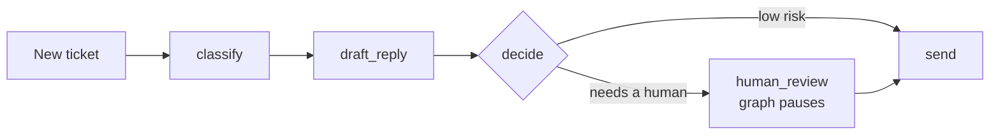

# AI Support Ticket Triage

A resumable, human-in-the-loop support ticket triage system for an IT services company. It classifies incoming client tickets, drafts replies, and either sends low-risk replies automatically or pauses for a technician to review. It runs on a local LLM (LM Studio) with an optional Groq cloud fallback, and includes layered defenses against prompt injection.

> **Status: prototype / proof of concept.** The final "send" step prints the reply instead of emailing it, so nothing is delivered to real customers yet. See [Limitations](#limitations).

<!-- Add a screenshot of the dashboard here, e.g.  -->

## Features

- **Resumable workflow (LangGraph).** State is checkpointed to SQLite after every step. A ticket can wait days for human approval, and a crashed run resumes from its last completed step instead of starting over.
- **Human-in-the-loop escalation.** The graph pauses with `interrupt()` and resumes when a reviewer approves, edits, or closes the ticket.
- **Multi-provider LLM layer.** Uses a local Qwen model through LM Studio first, with automatic fallback to Groq (`openai/gpt-oss-120b`). The mode can be switched per run from the dashboard: Auto, Local only, or Groq only.
- **Prompt injection defenses.** Multiple independent layers (see below).
- **Playbooks.** Admin-written troubleshooting guides. When a ticket matches one, the reply is built from the approved steps instead of the model's improvisation.
- **Streamlit dashboard.** Review queue, audit log of sent replies, ticket history, injection alerts, provider tracking, and playbook management.
- **Fails safe.** If every LLM provider fails, the ticket gets zero confidence and goes to the human queue rather than being lost.

## How it works



1. **classify** returns a category, urgency, confidence score, an injection self-report, and an optional matching playbook.
2. **draft_reply** writes a reply. If a playbook matched, it is built from the playbook's steps.
3. **decide** collects reasons to escalate. If there are none, the reply is sent.
4. **human_review** pauses the graph until a technician responds from the dashboard.
5. **send** delivers the reply (currently prints it).

### When is a reply sent automatically?

A reply is auto-sent only if **all** of these hold:

- Confidence is at least 0.7.
- The category is in `AUTO_SEND_CATEGORIES` (default: `general_question`, `service_request`), or a matched playbook has auto-send enabled.
- Urgency is `low` or `medium`.
- No prompt injection flags were raised.
- The draft passed its safety checks (no unapproved links, unexpected email addresses, credentials, or prompt leakage).
- The sender's domain is known, if `KNOWN_CLIENT_DOMAINS` is configured.

Anything else is escalated, and the dashboard shows the reasons.

## Prompt injection defenses

Ticket text is untrusted input. No single defense is perfect, so the system layers several:

1. Unicode normalization, removal of zero-width and control characters, and a length cap.
2. Pattern scanning for known injection phrasings, fake `system:` lines, chat-template tokens, hidden HTML comments, and markdown image exfiltration.
3. Untrusted text is isolated in randomly named tags, only in the user message, and the system prompt marks it as data.
4. The classifier self-reports injection attempts.
5. Classifier output is validated against allow-lists.
6. The models have no tools. Drafts are scanned for external links, unexpected emails, credential-like strings, and prompt leakage.
7. Any flag forces human review, and only low-risk categories can auto-send.
8. The dashboard renders ticket text as plain text, never as markdown.

The pattern list only catches known phrasings, so the structural protections (no tools, human review, a small auto-send list) matter most.

## Setup

**Requirements:** Python 3.10+, [LM Studio](https://lmstudio.ai) with a chat model loaded, and optionally a [Groq](https://console.groq.com) API key.

```bash
git clone https://github.com/YOUR-USERNAME/ai-ticket-triage.git
cd ai-ticket-triage

python3 -m venv .venv
source .venv/bin/activate
pip install -r requirements.txt

cp .env.example .env      # then edit .env with your values
```

In LM Studio, load a model, open the **Developer** tab, and set **Status: Running**. Find the exact model identifier:

```bash
curl http://localhost:1234/v1/models
```

Put that identifier in `.env` as `LMSTUDIO_MODEL`, then check the connection and start the dashboard:

```bash
python diagnose.py        # optional: shows what the local model returns and how long it takes
streamlit run app.py
```

## Configuration

Settings are read from environment variables or a `.env` file. Never commit `.env`.

| Variable | Purpose | Default |
|---|---|---|
| `LMSTUDIO_MODEL` | Model identifier from `/v1/models` | `qwen3.5-9b` |
| `LMSTUDIO_URL` | LM Studio server address | `http://localhost:1234/v1` |
| `LMSTUDIO_TIMEOUT` | Seconds without a token before giving up | `180` |
| `LMSTUDIO_MAX_TOKENS` | Cap on tokens per local reply | `4000` |
| `LMSTUDIO_NO_THINK` | Best-effort: ask Qwen to skip slow reasoning | off |
| `GROQ_API_KEY` | Enables the Groq fallback (`openai/gpt-oss-120b`) | unset |
| `COMPANY_NAME` | Name used in prompts and reply signatures | `Acme IT Services` |
| `COMPANY_DOMAIN` | Domain allowed in drafts (links and emails) | unset |
| `KNOWN_CLIENT_DOMAINS` | Comma-separated sender domains; others are escalated | unset (check off) |
| `ALLOWED_LINK_DOMAINS` | Comma-separated official vendor domains drafts may link to | unset |
| `PLAYBOOKS_PATH` | Playbook file location | `playbooks.json` |
| `TRIAGE_DB` | SQLite database path | `triage.db` |

Tuning constants such as `CONFIDENCE_THRESHOLD`, `AUTO_SEND_CATEGORIES`, and the ticket categories are at the top of `triage.py`.

## Dashboard

| Tab | What it does |
|---|---|
| Needs review | Shows escalated tickets with the original message, escalation reasons, injection warnings, and an editable draft. Approve and send, or close with no reply. |
| Sent replies | Audit log of every reply sent, filterable by auto-sent or human-reviewed, with the original LLM draft shown beside human edits. |
| All tickets | Table of all tickets with category, urgency, confidence, playbook, provider used, and escalation reason. Interrupted runs can be resumed here. |
| New ticket | Submit a ticket, or load sample tickets, including one containing an injection attempt. |
| Playbooks | Add, replace, and delete approved troubleshooting guides. Changes apply to the next ticket. |

The sidebar selects the LLM mode (Auto, Local only, Groq only) for newly submitted or resumed tickets.

## Playbooks

A playbook is a short, approved list of troubleshooting steps for a common problem, stored in `playbooks.json`:

```json
{
  "id": "wifi_single_device",
  "title": "Wi-Fi not connecting (one device)",
  "when": "One device cannot connect to Wi-Fi while others work",
  "auto_send": true,
  "steps": "1. Turn Wi-Fi off and on.\n2. Restart the device.\n3. Forget the network and reconnect."
}
```

The classifier picks a matching playbook by its `when` description, and the drafter rewords your steps for the client without adding new technical steps. With `auto_send` off, the drafted reply goes to a human for approval first.

## Project structure

```
app.py             Streamlit dashboard
triage.py          LangGraph workflow, LLM provider layer, safety checks
diagnose.py        Checks what the local model returns and how long it takes
playbooks.json     Example troubleshooting playbooks
.env.example       Template for configuration
requirements.txt   Python dependencies
```

## Limitations

- **Prototype.** `send()` in `triage.py` only prints the reply. Replace it with your email or PSA (ConnectWise, Autotask, Zendesk, etc.) integration.
- **Tickets are entered manually** through the dashboard form. There is no helpdesk or email ingestion yet.
- **Small local models are imperfect.** A 9B model's self-reported confidence is not reliable, and thinking models can be slow on laptops. The category allow-list and human review do most of the safety work.
- **Groq fallback sends ticket text to a third-party cloud.** Use Local only mode, or leave `GROQ_API_KEY` unset, for sensitive client data.
- **Prompt injection cannot be fully solved.** The defenses reduce risk but do not eliminate it.
- **No automated test suite or accuracy measurements yet.** Behavior was checked during development with simulated LLM responses; classification accuracy on real tickets has not been measured.
- **Single-user dashboard.** There is no login or per-user permissions.

## Roadmap ideas

- Real email and helpdesk integrations (inbound and outbound)
- Accuracy evaluation on a labeled ticket set
- Authentication and reviewer audit trails
- Per-client playbooks and SLA-aware routing

## Acknowledgements

Built with [LangGraph](https://github.com/langchain-ai/langgraph), [LangChain](https://github.com/langchain-ai/langchain), [Streamlit](https://streamlit.io), [LM Studio](https://lmstudio.ai), and [Groq](https://groq.com). Developed with AI coding assistance (Claude).

## License

Add a license of your choice (for example MIT) as a `LICENSE` file, and mention it here.
